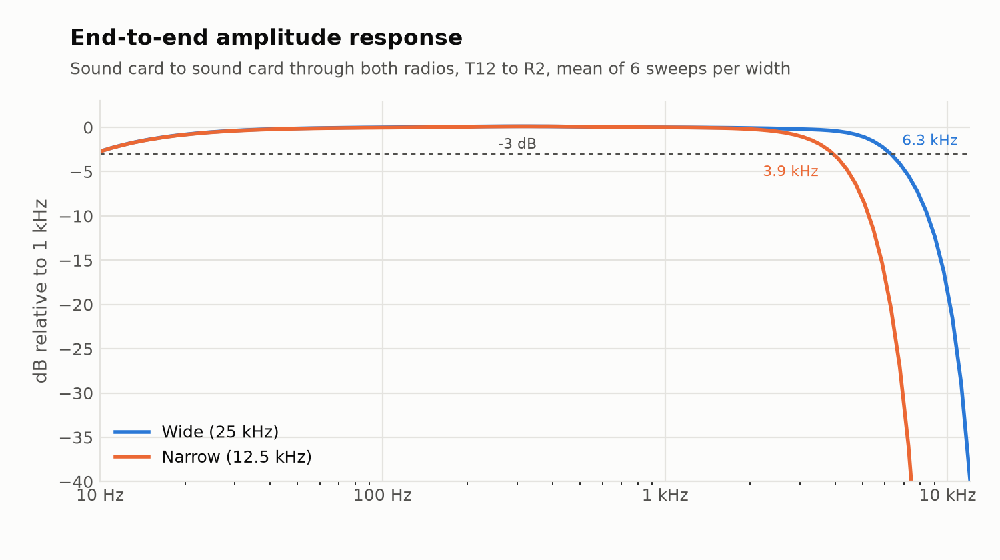
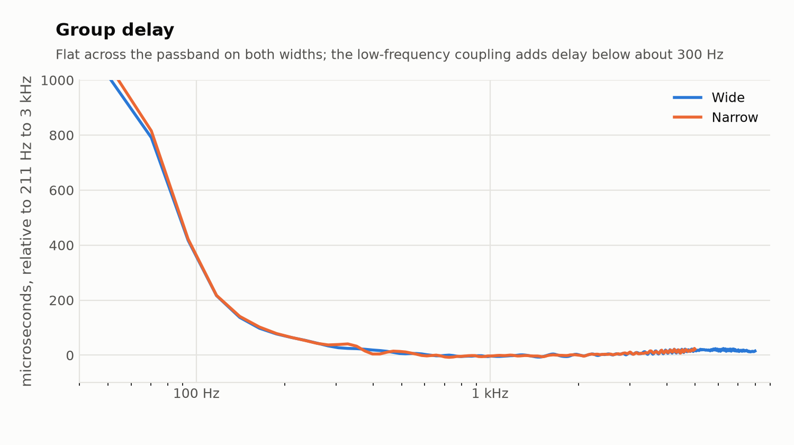
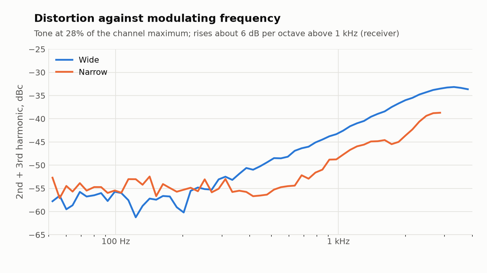
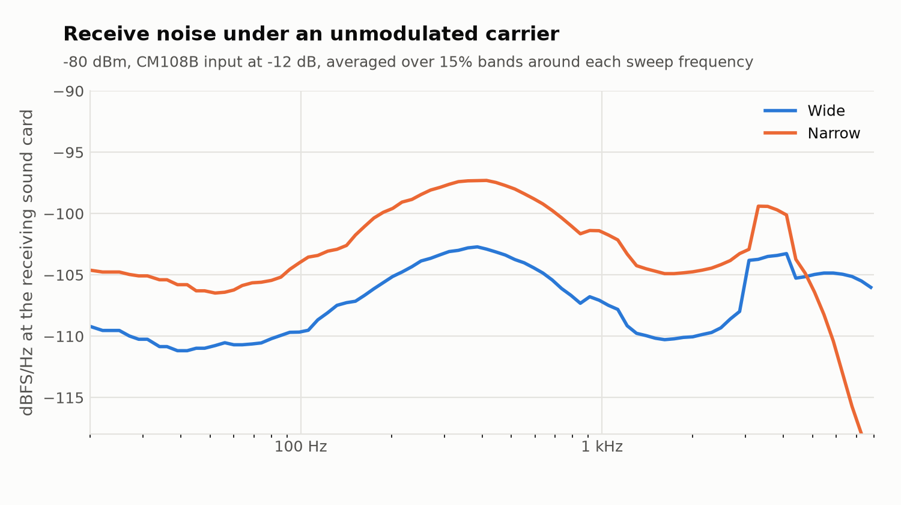
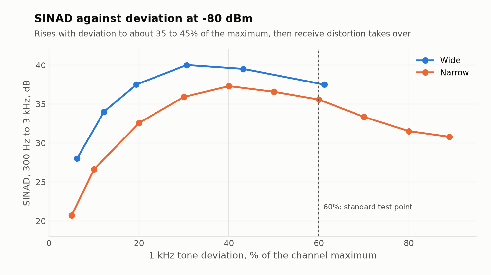

# Tait TM8110 + tait-cm108: bench factsheet

What a bench of two Tait TM8110 radios with the [packethacking/tait-cm108](https://github.com/packethacking/tait-cm108) internal options board shows about that combination, for anyone setting one up or building modems for it. It is about the radios and the board; what a particular modem makes of them belongs with that modem (there are pointers under [For modem builders](#for-modem-builders)). Measured November 2026. The scripts are in [tools/](tools/), with a how-to in [tools/README.md](tools/README.md); raw data is in [data/](data/).

**Headline:**

1. **Set the CM108B's "MIC PLL Adjust" EEPROM bit on every board.** As shipped, its capture clock is not locked to anything: it ran 1700 to 1840 ppm fast on these two boards through one night and about 370 ppm fast on the same boards four days earlier. Tones and AFSK do not notice; anything that assumes the two ends sample at the same rate does. One EEPROM word locks it. See [Sample clock](#cm108b-sample-clock).
2. **Fit R11 = 2k0 (not 3k3).** With the transmit tap on T12, the as-built divider limits full-scale deviation to 62% of the channel maximum; 2k0 gives 88 to 90%. On the densest ofdm-fm preset that doubled the frames delivered. See [Output level: R11](#output-level-r11).
3. **Use R2 and T12.** Both are levelled by the radio to the channel width, so one set of levels serves Narrow and Wide.
4. Otherwise the board works as built: linear, two boards matched within 0.4 dB, audio flat from 30 Hz to about 5 kHz.
5. **Check each receiver for a tone under a quiet carrier.** These radios add a narrow tone to their own receive audio, on every channel, at a frequency that follows the radio's temperature: 21 dB over the noise near 3.7 kHz on one unit, 9 dB near 1.2 kHz on another. It costs a wide OFDM signal two or three carriers and nothing else. There is a one-line test. See [Receive tones](#receive-tones).

## Verdict

**With two fixes (the MIC PLL Adjust EEPROM bit and R11 = 2k0), the tait-cm108 board makes the TM8110 an excellent radio for conventional packet, up to and including C4FSK speeds. For ofdm-fm it is good on Wide; the remaining limits are the radio's receiver and the CM108B's clock, and the next gains are in software rather than hardware.**

What is good:

- **The audio path is about as clean as an FM radio gets.** Flat from about 8 Hz to 5 kHz on Wide (3 kHz on Narrow), near-linear phase, no pre-emphasis or de-emphasis in the way, so 9600 and C4FSK get almost DC-coupled audio. Most sound card interfaces cannot offer that.
- **Turnaround is fast and predictable.** Modulation is steady 2 ms after the carrier, the receiver opens and closes within 3 ms, and there is no squelch tail, so TXDELAY can be short.
- **Linear and consistent.** Deviation tracks level within hundredths of a dB, two boards match within 0.4 dB, and repeated measurements agree within a few hundredths of a dB.
- **Well integrated.** One USB lead carries audio, PTT and the radio's CCDI control port, so a modem gets real RSSI and carrier sense from the radio instead of guessing from audio.
- **Clean transmit**: -56 dBc distortion at full scale.

What needed fixing (both are cheap):

- **Capture clock**: as shipped it runs free, anything from 370 to 1840 ppm fast. One EEPROM bit locks it to USB timing, and boards should ship with it set.
- **Output level**: 62% of the maximum deviation on T12 as built. R11 = 2k0 brings it to 88 to 90%, which doubled delivery on the hardest ofdm-fm preset.

What limits it:

- **The CM108B has no crystal.** Even locked, its clocks hunt: from one key-up to the next the rate between two boards is anywhere within about 300 ppm of nominal, and inside a transmission it steps by hundreds of ppm for tens of milliseconds at a time. Every single-carrier mode copes. A wide OFDM modem has to measure the clock from each burst and follow it; one that does loses nothing to it. A crystal-referenced codec would avoid the issue altogether.
- **The radio's receiver distortion.** SINAD tops out at about 37 to 40 dB, and above 30 to 40% of the maximum deviation the receiver's own distortion is the limit. That is typical of a good analogue FM radio and far more than AFSK, 9600 or C4FSK need, but it is the ceiling for dense OFDM.
- **Narrow channels.** About 4 kHz of usable audio on Narrow rules out the wide OFDM presets on 12.5 kHz channels. That is the radio's IF filter, not the interface.
- **Minor**: the board's second serial port ("TaitProgramming") does nothing, programming still needs a lead in the mic socket, and on the bench one board's sound card dropped off USB once in about 14 hours of use.

## Test setup

| | |
|---|---|
| Radios | Tait TM8110 (TMAB12-B100), serials 19925369 and 19924394, firmware 2.18, codeplug database 0094 |
| Interface | tait-cm108 board on each radio's internal options connector, USB to a Raspberry Pi 4, one Pi per radio |
| Channel | 146.500 MHz, Very Low power (1 W), Wide (25 kHz) unless stated |
| RF path | 112 dB of attenuation between the radios (5 W 6 dB pads at each radio, low-power pads between), about -80 dBm at each receiver |
| Modem | pdn-soundmodem 0.108.0, one instance per radio |
| Deviation measured with | SDRplay RSP1 with a small antenna laid against the coax (IFGR=50), on a third computer since 18 Nov with the open [OpenRSP](https://openrsp.dev/) driver, FM-demodulated in software; cross-checked against the FM sideband amplitudes of a steady tone (agree within 0.2%) |

Each board appears on USB as a hub carrying a CM108B sound card, a CP2102N "TaitInterface" serial port (the radio's internal serial port, IOP_TXD/RXD) and a CP2102N "TaitProgramming" port.

**Pin the device names.** Linux numbers sound cards and hidraw nodes in the order they appear, so a board that re-enumerates can come back under another name and its modem cannot find it. [tools/99-tait-cm108.rules](tools/99-tait-cm108.rules) names each board by its USB serial number (ALSA card `Tait<serial>`, PTT `/dev/tait-ptt-<serial>`); point the modem configuration at those names.

**Lessons about the bench itself:**

- **At -80 dBm the receivers are not fully quieted above 1 kHz.** Taking 3.5 dB out of the path (an SDR tee) raised receive noise above 1 kHz by 2 to 3 dB and cost the margin preset most of its frames. Keep the path loss fixed between anything you compare.
- **An SDR on a tee is a good deviation meter** (48 dB in-channel signal to noise) but **cannot verify an attenuator chain**: with a 1 W transmitter nearby it picks the signal up by other routes at roughly 60 dB below the transmitter, so readings stop falling once the wanted signal is weaker than that. Check pad chains with the radios' own RSSI instead.
- **SMA joints can pass DC and not RF.** A continuity check across a pad chain proves nothing about attenuation; a joint that is not fully mated can lose 15 dB. Check end-to-end RF level against the sum of the pads.
- **Frame counts from a clock-sensitive modem move from minute to minute** with nothing changed (`ofdm-fm-8k` on pdn-soundmodem 0.108.0 swung between 60% and 100% within the hour). The cause turned out to be the sound cards' clocks, which wander more at some times than others (see [Sample clock](#cm108b-sample-clock)). Compare settings only in interleaved rounds, at least four rounds of 20 frames each way.
- **A board can be power-cycled from its Pi**, which is what an EEPROM change needs: `sudo uhubctl -l 2 -a off; sudo uhubctl -l 1-1 -a off`, wait 8 s, then both `-a on`. The sound card comes back with its mixer at defaults (output at -20 dB), so set the levels again afterwards.

## Codeplug

Start from the radio's default codeplug, apply the `pdn-internal` profile from [tait-codeplug](https://github.com/M0LTE/tait-codeplug), set the transmit tap to T12, and set the channel (frequency, width, power) for the setup. The bench's field list is in [data/codeplug-bench.txt](data/codeplug-bench.txt) and its change from default in [data/codeplug-bench.diff](data/codeplug-bench.diff).

| Setting | Value | Why |
|---|---|---|
| Data port | Internal Options, Command mode at power-up, 28800 baud | CCDI control and telemetry (RSSI etc.) over the board's TaitInterface port |
| PTT | IOP_GPIO1 = External PTT 1, active low; EPTT1 transmits Data from Audio Tap In | the board's PTT transistor (CM108 GPIO3) pulls IOP_GPIO1 low |
| Rx tap out | **R2**, type D (split), unmuted except on PTT | after the deviation normaliser, so receive level does not depend on channel width; flat, unsquelched discriminator audio |
| Tx tap in | **T12** | before the deviation scaler, so deviation scales with channel width |
| AUX_GPI1 | Unassigned | so only the board can key the radio |
| Tx timer | 250 s | the default 60 s cuts long transmissions |

Tap points, from Tait's diagram and confirmed by measurement:

- **T12** sits between the limiter/3 kHz low-pass and the deviation scaler. The radio scales it to the channel, so a level set on Narrow is right on Wide (measured: Wide is exactly 6.0 dB above Narrow). It bypasses the limiter, low-pass and pre-emphasis, so **nothing in the radio stops over-deviation**: the audio level is the only guard.
- **T13** is after the scaler: the same audio gives the same kHz on any width. It is 3.8 dB more sensitive than T12 on Narrow. **With R11 = 2k0, T13 would over-deviate a Narrow channel at full scale** (about 3.5 kHz against the 2.5 kHz maximum), so do not use T13 with the modified board.
- **R2** is after the normaliser but before the 3 kHz low-pass, 300 Hz high-pass and de-emphasis, so wide-band and low-frequency content reach the modem. Tait warn that R1, R2 or R4 with tap type C (bypass) plus subaudible signalling makes the mute misbehave; type D with no subaudible avoids it.

## Programming the radios

- Codeplug programming only works through the **front panel mic socket** with a programming lead. The internal options connector has one serial pair and no programming lines, and the radio never gives the programming handshake on it. The board's "TaitProgramming" port does not respond.
- When the data port is not Mic, the mic socket programs without a power-cycle.
- The internal port obeys the CCDI `^` (reset) character. A tool that retries `^` while waiting for a programming banner holds the radio in a reboot loop.
- **Channels can be changed without the lead.** Program several channels once, then CCDI `g` on the internal port selects one: `g1` to `g9` were accepted here and `g10` was not, on a ten-channel codeplug. The bench radios hold nine extra simplex channels between 146.000 and 146.550 MHz, all Wide and Very Low, with 146.500 MHz still channel 1.
- **The codeplug's per-channel birdie killer** (see [Receive tones](#receive-tones)) is `ch<N>.birdiekiller` in tait-codeplug from [#27](https://github.com/M0LTE/tait-codeplug/pull/27), not yet in a release. Earlier versions showed its working bit as `splittx`, which it never was: a split channel is simply one whose TX frequency differs from its RX frequency. Both bench radios read `birdiekiller=true` on the bench channel.
- **The radio reports its PA temperature** over CCDI: CCTM query 47 (`q` with parameter `5047`) answers in degrees C and then in millivolts. 27 to 29 degrees idle here, 33 after 100 s of transmitting at 1 W.
- A radio from elsewhere can arrive on any channel at High power. Program Very Low and the bench channel before it is ever keyed into a pad chain.
- tait-codeplug: `patch <port> profile` crashes in 0.15.x; it is fixed on main ([#24](https://github.com/M0LTE/tait-codeplug/pull/24)), which also adds `write <port> <file>` for writing a prepared codeplug in one go ([#25](https://github.com/M0LTE/tait-codeplug/pull/25)), not yet in a release.

## Transmit

**Deviation against sound card level**, T12, Wide, 1 kHz tone, CM108B output at 0 dB (its maximum), R11 = 2k0, two boards:

| Sound card level | Deviation | Share of the 5 kHz maximum |
|---|---|---|
| -20 dBFS | 0.44 to 0.45 kHz | 9% |
| -10 dBFS | 1.39 to 1.42 kHz | 28% |
| -6 dBFS | 2.20 to 2.26 kHz | 45% |
| -3 dBFS | 3.11 to 3.19 kHz | 63% |
| 0 dBFS | **4.39 to 4.50 kHz** | **88 to 90%** |

On Narrow every figure is half (T12 scales), so full scale is about 2.2 kHz of the 2.5 kHz maximum.

- **Linear:** every 3 to 6 dB step lands within 0.01 to 0.05 dB of what was sent.
- **Clean:** second plus third harmonic -56 dBc at full scale; residual FM about 12 to 30 Hz rms.
- **Matched:** boards within 0.4 dB of each other.
- **What a real ofdm-fm burst deviates to:** measured before the change at 0.69 kHz rms with 2.65 kHz peaks (crest factor 11.7 dB, peaks at 87% of a full-scale sample); scaled to R11 = 2k0, about 1.0 kHz rms and 3.8 kHz peak. The sine figure is the ceiling; the burst is what the link runs on.
- **Supply:** a radio on a noisy mains supply showed a 100 Hz buzz on its transmitted carrier (14 Hz rms of deviation), gone on battery. Worth checking the residual FM of a quiet carrier on any new setup.

## Receive

Receiving radio on R2, CM108B input at -12 dB (its minimum), AGC off.

| | |
|---|---|
| Open channel, no carrier | -19 to -21 dBFS rms, peaks -11 to -12 dBFS (unsquelched discriminator noise) |
| 1 kHz tone at 1 kHz peak deviation | -35.6 dBFS rms on Wide, -29.6 dBFS rms on Narrow |
| Same share of the channel's maximum | same level on Narrow and Wide (R2 normalises) |
| Linearity | received level tracks transmitted level within 0.1 dB |

SINAD (300 Hz to 3 kHz) against deviation, 1 kHz tone, Wide, -80 dBm:

| Deviation | 0.31 kHz | 0.61 kHz | 0.97 kHz | 1.53 kHz | 2.16 kHz | 3.06 kHz |
|---|---|---|---|---|---|---|
| SINAD | 28 dB | 34 dB | 37 to 38 dB | **40 dB** | 39 to 40 dB | 37 to 38 dB |

- **Below about 1.5 kHz of deviation, more deviation means better SINAD, dB for dB.**
- **Above that, receive-side distortion takes over:** the third harmonic in the received audio rises from below -45 dBc to -34 dBc at 3 kHz, while the transmitted signal is clean. On a strong signal, extra deviation does not make a tone cleaner; on a weak one, where noise is the limit, it does.
- **Leave the CM108B input gain at -12 dB.** With it 10 dB higher, signal, noise and SINAD all move together, so the sound card's own noise is irrelevant, and the open-channel noise peaks reach -1.4 dBFS.

## End-to-end audio channel

Sound card to sound card through both radios and the RF path: the sending CM108B, the board's output network, the transmitter (T12), the receiver (R2), the receiving board's input network and CM108B. Both channel widths, both directions, three sweeps each (100 tones, 10 Hz to 12 kHz, at -10 dBFS, which is 28% of the channel's maximum deviation on either width), plus a 512-tone multitone for phase and two key-up timings per direction. Raw results in [data/e2e/](data/e2e/); the scripts are [tools/e2etx.py](tools/e2etx.py) and [tools/e2ean.py](tools/e2ean.py).

**Repeatability:** the three sweeps agree within 0.02 to 0.04 dB across the passband, and the two directions within 0.12 dB. These figures describe the combination, not one unit.

**Amplitude**, relative to 1 kHz, mean of all six sweeps per width:

<picture><source media="(prefers-color-scheme: dark)" srcset="img/response-dark.png"></picture>

| Frequency | Wide | Narrow |
|---|---|---|
| 10 Hz | -2.7 dB | -2.7 dB |
| 15 Hz | -1.4 dB | -1.4 dB |
| 20 Hz | -0.8 dB | -0.8 dB |
| 30 Hz | -0.4 dB | -0.4 dB |
| 50 Hz | -0.1 dB | -0.1 dB |
| 100 Hz to 1 kHz | within 0.1 dB | within 0.1 dB |
| 2 kHz | -0.1 dB | -0.2 dB |
| 2.5 kHz | -0.1 dB | -0.5 dB |
| 3 kHz | -0.2 dB | -1.0 dB |
| 3.5 kHz | -0.3 dB | -1.8 dB |
| 4 kHz | -0.4 dB | -3.2 dB |
| 4.5 kHz | -0.6 dB | -5.3 dB |
| 5 kHz | -1.0 dB | -8.1 dB |
| 5.5 kHz | -1.6 dB | -11.9 dB |
| 6 kHz | -2.4 dB | -16.9 dB |
| 6.5 kHz | -3.5 dB | -23.3 dB |
| 7 kHz | -4.7 dB | -31.3 dB |
| 7.5 kHz | -6.2 dB | -41.5 dB |
| 8 kHz | -8.0 dB | -55 dB |
| 9 kHz | -12.3 dB | below -60 dB |
| 10 kHz | -18.6 dB | below -60 dB |

| | Wide | Narrow |
|---|---|---|
| Low-frequency -3 dB point | about 8 Hz | about 8 Hz |
| Ripple, 30 Hz to 3 kHz | 0.5 dB p-p | 1.0 dB p-p (the top end already falling) |
| -1 dB | 4.95 kHz | 3.0 kHz |
| -3 dB | 6.3 kHz | 3.9 kHz |
| -6 dB | 7.4 kHz | 4.65 kHz |
| -10 dB | 8.5 kHz | 5.3 kHz |
| -20 dB | 10.2 kHz | 6.3 kHz |

- **The low end is set by the board and is the same on both widths:** a single first-order corner near 8 Hz, so 9600 and C4FSK get practically DC-flat audio down to about 30 Hz.
- **The top end is the receiver's, and scales with the channel width.** A preset that fits Wide does not fit Narrow: on Narrow, anything above about 3.5 kHz is down 2 dB or more and the band is effectively closed above 5 kHz. (The transmit side alone is flat within 0.5 dB to 6.5 kHz, measured separately with an SDR.)

**Phase.** Group delay, relative to its average from 211 Hz to 3 kHz, from the multitone:

<picture><source media="(prefers-color-scheme: dark)" srcset="img/group-delay-dark.png"></picture>

| Band | Wide | Narrow |
|---|---|---|
| 50 to 211 Hz | +125 to +145 microseconds (median), rising to about +750 at 23 Hz | the same |
| 211 Hz to 3 kHz | within plus or minus 30 to 70 microseconds (the scatter is the measurement's) | the same |
| 3 to 5 kHz | median +11 to +13 microseconds | the same |
| 5 to 6.5 kHz | median +18 to +21 microseconds | median +13 to +20, scatter plus or minus 100 |
| Above the -20 dB point | not meaningful | not meaningful |

The channel is close to linear-phase across its passband on both widths: no measurable group-delay rise towards the top edge before the amplitude has already fallen 20 dB. Only the low-frequency corner adds delay, a few hundred microseconds below 100 Hz.

**Distortion** (second and third harmonics of each sweep tone, at 28% of maximum deviation):

<picture><source media="(prefers-color-scheme: dark)" srcset="img/distortion-dark.png"></picture>

| Tone | Wide H2 / H3 | Narrow H2 / H3 |
|---|---|---|
| 100 Hz to 1 kHz | -53 to -56 / -56 dBc | -56 / -58 dBc |
| 1 to 2 kHz | -41 / -44 dBc | -47 to -49 / -49 dBc |
| 2 to 3 kHz | -36 / -39 to -40 dBc | -44 / -42 dBc |
| 3 to 4 kHz | -34 to -35 / -40 dBc | -42 / -45 dBc |

Distortion rises with modulating frequency on both widths, by about 6 dB per octave above 1 kHz: second harmonic -55 dBc at low frequencies, -35 dBc at 3 to 4 kHz on Wide. It is the receiver's (the transmitted signal is cleaner than -55 dBc). Harmonics of the upper tones fall partly in the roll-off, so above about 3 kHz on Wide and 2 kHz on Narrow these figures flatter the channel.

**Noise under an unmodulated carrier** at -80 dBm, receive audio with the CM108B input at -12 dB:

<picture><source media="(prefers-color-scheme: dark)" srcset="img/noise-dark.png"></picture>

| Band | Wide | Narrow |
|---|---|---|
| 100 Hz to 1 kHz | -105 dBFS/Hz | -99 dBFS/Hz |
| 1 to 3 kHz | -110 dBFS/Hz | -104 to -105 dBFS/Hz |
| 3 to 4 kHz | -101 to -106 dBFS/Hz | -97 to -102 dBFS/Hz |

A tone at the same share of the channel's maximum deviation arrives at the same level on both widths (-32.5 dBFS rms for this sweep), so Narrow has about 5 to 6 dB less signal to noise than Wide at the same RF level, as expected for half the deviation.

**SINAD and FM hum and noise.** SINAD here is a 1 kHz tone's power against everything else between 300 Hz and 3 kHz (unweighted, no de-emphasis, since R2 has none), at -80 dBm. The standard single figure is taken at 60% of the channel's maximum deviation (3 kHz on Wide, 1.5 kHz on Narrow). FM hum and noise is that 60% tone against the residual with the carrier unmodulated, in the same band.

<picture><source media="(prefers-color-scheme: dark)" srcset="img/sinad-dark.png"></picture>

| | Wide | Narrow |
|---|---|---|
| Peak SINAD | **39.5 dB**, at 30% of maximum | **37.3 dB**, at 40% |
| SINAD at 60% (the standard figure) | **34.1 dB** | **35.6 dB** |
| SINAD at 89% (sound card full scale) | 30.3 dB | 30.8 dB |
| Distortion of the 1 kHz tone at 60% | -33.6 dBc | -35.5 dBc |
| FM hum and noise (60% tone against unmodulated carrier) | **44.8 dB** | **39.4 dB** |

Each width is the mean of four runs, two each way, which agree within 1 dB.

- **SINAD rises with deviation only up to 30 to 40% of the maximum.** Beyond that the receiver's own distortion dominates: on a strong signal the channel is distortion-limited, not noise-limited. On a weak signal the peak would move to higher deviation.
- **Below the peak, Wide is 2 to 6 dB better** (twice the deviation for the same share of the channel, and noise is the limit there). **Above about 45%, Narrow is as good or slightly better,** because Wide's larger deviation brings more receiver distortion. The hum and noise ratio, which has no distortion in it, is 5.4 dB better on Wide.
- **Not measured: 12 dB SINAD sensitivity** (the RF level at which SINAD falls to 12 dB, the receiver's weak-signal limit). It needs the RF level stepped, by changing pads; at a fixed -80 dBm every figure here is the strong-signal case.

**Key-up and key-down timing**, seen at the receiver with the transmitting card already playing a tone when PTT changes:

| | Wide | Narrow |
|---|---|---|
| Carrier arrives (receiver quiets) to modulation steady (within 1 dB) | 1.7 to 2.7 ms | 2.0 to 2.5 ms |
| Modulation leaves its steady level to carrier gone | 1.8 to 2.6 ms | 1.7 to 2.6 ms |
| Carrier duration against PTT duration | 5 ms shorter | 5 to 6 ms shorter |
| Receiver: open noise to quieted | within 3 ms | within 3 ms |

So the T12 path is live as soon as there is carrier, the receiver opens and closes within a few milliseconds, and there is no squelch tail (R2 is unsquelched). TXDELAY only needs to cover the transmitter's own time from PTT to carrier plus the modem's acquisition; TXTAIL only needs to cover the sound card's output buffer.

### Sound card settings

Checked on both boards, and how the bench runs:

| | Setting |
|---|---|
| ALSA controls | Output (PCM) 0 dB, its maximum; input (Mic) -12 dB, its minimum; **Auto Gain Control off**. No mic boost control and no mic-to-output monitor path exist on this board (the CM108B's mixer path is strapped off). |
| EEPROM | **Mic high-pass filter off, mic boost off**, MIC PLL Adjust on, total power control off, DAC active, volume limits not overridden |
| Sound server | none: programs open the card directly |
| Device | the raw hardware device (`hw:`), 48 kHz, 16-bit; capture is mono and playback stereo (the board uses the left channel), so no conversion layer is needed |
| Other processing | none exists on the CM108B beyond AGC, mic boost and the high-pass filter |

pdn-soundmodem forces AGC off and sets the two levels itself at start-up when its configuration has an `alsa.mixer` section.

## Noise and signal quality across the band

**Noise floor** under an unmodulated carrier at -80 dBm (receive audio, input at -12 dB): about -110 dBFS/Hz below 100 Hz, -105 dBFS/Hz from 100 Hz to 1 kHz, -109 dBFS/Hz from 1 to 3 kHz, -104 to -105 dBFS/Hz from 4 to 8 kHz. Against a tone at 1 kHz of deviation on Wide that is 43 to 56 dB in 100 Hz across the band. Small tones near 1 kHz and 4 kHz about 10 dB above the floor are probably USB frame-rate pickup on the board.

**Signal quality with an OFDM-like signal** (84 tones from 211 Hz to 8 kHz with gaps between them; tone power against what fills the gaps), R11 = 3k3 levels:

| Drive (rms) | 0.2 to 1 kHz | 1 to 2 kHz | 2 to 3 kHz | 4 to 5 kHz | 5 to 6 kHz | 7 to 8 kHz |
|---|---|---|---|---|---|---|
| -12 dBFS | 39 to 40 dB | 38 dB | 33 to 35 dB | 29 to 30 dB | 27 to 28 dB | 24 to 25 dB |
| -18 dBFS | 34 to 35 dB | 39 dB | 37 dB | 32 to 33 dB | 31 dB | 27 to 28 dB |

Quality falls about 15 dB across the band, and above 1 kHz lower drive is cleaner, so distortion as well as noise sets it at these levels. -12 dBFS rms is where an `ofdm-fm-8k` burst sits. The method understates distortion (third-order products land on the tones, not in the gaps); treat the figures as upper bounds.

**The same thing measured with real bursts**, R11 = 2k0, full drive: 640 `ofdm-fm-8k` bursts, each sent four times and compared with the samples that were played once the sound cards' clock had been taken out. What differs between copies of one burst is noise; what repeats but was not sent is distortion.

| Audio band | Signal to noise | Signal to distortion | Signal to both |
|---|---|---|---|
| 0.2 to 1 kHz | 34 to 37 dB | 46 to 47 dB | 34 to 36 dB |
| 1 to 2 kHz | 39 to 41 dB | 40 to 43 dB | 37 to 38 dB |
| 2 to 3 kHz | 39 to 40 dB | 36 to 37 dB | 34 to 35 dB |
| 3 to 4 kHz | 33 dB (27.6 into the radio with the tone) | 31 to 32 dB | 29 dB (26) |
| 4 to 6 kHz | 30 to 32 dB | 29 to 30 dB | 27 to 28 dB |
| 6 to 8 kHz | 26 to 29 dB | 26 to 28 dB | 23 to 26 dB |

- **Above about 1.5 kHz at full drive the limit is distortion, not noise.** It repeats exactly between copies, rises with frequency and falls 3 to 4 dB when the drive is taken down 3 dB, which is what second-order distortion in the receiver does. Noise moves the other way, so the total hardly changes between full drive and -3 dB.
- **The channel is 13 dB better at 1.5 kHz than at 7.5 kHz**, where its gain falls only 8 dB. A modem that weights carriers by gain alone trusts the top of the band too much.
- **Above about 3 kHz the noise at -80 dBm is the receiver's thermal noise.** FM theory for a noise figure of 7 dB puts it at -107.5 dBFS/Hz at 4 kHz, rising 6 dB an octave; measured, -106 dBFS/Hz from 3 to 5 kHz. So up there it rises dB for dB as the path gets weaker (the 3.5 dB an SDR tee took out of the path raised it 2 to 3 dB). Below about 1.5 kHz it is a floor of the radios' own, 20 dB over the thermal figure at 500 Hz, which more path loss does not move until the thermal noise reaches it.

## Receive tones

**These radios put a narrow tone into their own receive audio, and its frequency follows the radio's temperature.** It shows whenever a carrier quiets the receiver. One of the three radios tried has it strongly, one had it more strongly still, and the third has weaker ones.

| Radio | Tone | Level |
|---|---|---|
| 19925328 (since replaced) | 3.88 to 4.05 kHz | 23 to 26 dB over the noise around it |
| 19924394 | 3.5 to 3.9 kHz (4.0 kHz with the birdie killer off) | 21 to 22 dB over the noise in 23.4 Hz, about 16 Hz of deviation |
| 19925369 | about 1.2 kHz, and about 3.6 kHz | 7 to 9 dB, and 2 to 5 dB |

Both radios also show a faint tone (2 dB or less) that changes with the channel and not with temperature, 585 Hz on 146.500 MHz. That one is on the transmitted carriers, about 2 Hz of deviation, and is not the subject here.

What is established, on 19924394:

- **It is the same on every channel.** Nine channels from 146.000 to 146.550 MHz, including ones chosen to move or remove it if it were a clock harmonic landing near the channel: the tone was there on all of them at 21 dB, between 3510 and 3867 Hz ([data/spurs/channels/](data/spurs/channels/)). Changing channel does not avoid it.
- **Its frequency is the radio's own temperature.** Idle, with the PA sensor at 27 degrees: 3604 Hz, creeping down 17 Hz in 100 s. Straight after that radio had transmitted for 100 s (sensor 33 degrees): 3783 Hz, sliding back to 3693 Hz over the next 100 s ([data/spurs/](data/spurs/), the two `track` files). About 30 Hz a degree; left alone in this room, at 28 to 29 degrees, it sits at about 3660 Hz.
- **It is added in the receive chain, not received.** It stays a few hertz wide under a full-drive OFDM burst, where a beat with a second carrier would be smeared across kilohertz by the modulation, and it is gone when the radio mutes its audio tap during its own transmission.
- **It is not one board, the supply or the programming lead.** It stayed with radio 19925328 when the boards were swapped, was the same on battery, and the same with the lead out. It also read the same with the board's capture clock locked and with it running free 1750 ppm fast, so the board's sampling is not what makes it.
- **It has only ever been heard through this design of board, fitted inside the radio.** No other audio interface has been tried, so whether the board's presence plays a part is not yet shown either way ([#1](https://github.com/M0LTE/tait-cm108-bench/issues/1)).
- **It is in the receive path only.** That radio's own transmitted carrier, heard by the SDR, has no tone there (nothing over 1 Hz of deviation between 3 and 4.2 kHz, where the receive tone is 16 Hz).
- **The source is the radio's system clock, beating with its reference.** Tait's service manual gives the receiver a 13.000 MHz temperature-compensated reference, a 13.012 MHz oscillator locked to it, and a separate 12.288 MHz system clock for the digital board, which samples the 64 kHz second IF and produces audio at 48 kHz. Those frequencies fold to exactly 4.000 kHz (13.012 MHz less 12.288 MHz is 724 kHz, which is fifteen times 48 kHz plus 4 kHz), and the result moves 13 Hz for every part per million the system clock is off (12.288 MHz is 256 times 48 kHz, so the sampling rate moves with it).
- **Tait's "birdie killer" proves it, and does not cure it.** The programming application has a per-channel "Activate Birdie Killer" option for "a hum or whistle on a channel caused by internal interference", and the service manual's block diagram shows a line of that name going to the system clock. It is the first two bits of the channel's record in the codeplug. On three channels of one radio, minutes apart ([data/spurs/birdie-killer-19924394.txt](data/spurs/birdie-killer-19924394.txt)):

  | Channel bits | Tone |
  |---|---|
  | both clear (the option unticked) | 4.00 to 4.02 kHz |
  | the first set (how both bench radios arrived) | 3.69 to 3.74 kHz |
  | both set (the option ticked) | 3.74 to 3.76 kHz |

  So the first bit pulls the system clock about 20 ppm fast and the tone goes down 255 to 275 Hz with it; the second does nothing that shows here. With the option off, the tone sits within 20 Hz of 4.000 kHz at room temperature, as the arithmetic says it should when the system clock is on frequency. Either way it stays inside the band a wide modem uses. The bench radios have had the first bit set all along, which is why their tones were found 250 to 500 Hz below 4 kHz.

**What it costs.** Two or three carriers of an 8 kHz OFDM signal lose 10 to 16 dB and the rest are as good as the other radio's. Which carriers changes as the radio warms and cools: it wanders over about seventeen of them, and by less than one during a burst. A notch is the wrong cure (it costs more carriers than the tone does, and the tone moves). A modem that weights each carrier by the noise it actually shows loses about half a decibel of margin to it.

**The test.** Key the far radio with no audio for 14 s, record the near radio's receive audio, and list every narrow tone that stands clear of the noise ([tools/wavan.py](tools/wavan.py) `spurs`, [tools/bench.sh](tools/bench.sh) `quiet`):

```sh
source tools/bench.sh; modems stop
quiet top q-top 14          # top radio sends a bare carrier, bottom radio's audio is recorded
ssh pi@radio2 'cd tait-pair && python3 wavan.py spurs q-top.wav'
```

```
14.2 s of quiet carrier; noise -109.9 dBFS/Hz at 1 to 3 kHz, -106.0 at 3 to 5 kHz
    993.8 Hz   -93.4 dBFS   +1.6 dB over the noise in 23.4 Hz  about 1.3 Hz of deviation  9 Hz wide  a multiple of 1 kHz: USB frame-rate pickup on the board
   3663.6 Hz   -71.3 dBFS  +21.8 dB over the noise in 23.4 Hz  about 16.5 Hz of deviation  6 Hz wide  not a multiple of 1 kHz: made in the radio
   3999.4 Hz   -88.2 dBFS   +4.0 dB over the noise in 23.4 Hz  about 2.3 Hz of deviation  6 Hz wide  a multiple of 1 kHz: USB frame-rate pickup on the board
FAIL: a tone that is not the USB frame rate stands 21.8 dB over the noise in one carrier (limit 10)
```

It reports each tone's frequency, its level, how far it stands over the noise in 23.4 Hz (the width of one `ofdm-fm` carrier, so the figure is roughly what that carrier loses), and the deviation it amounts to. Tones at multiples of 1 kHz are the USB frame rate picked up on the board; they are small and are not counted. It exits 1 if anything else stands more than 10 dB clear. Both radios' results are in [data/spurs/](data/spurs/). Run it in both directions on any new pair, with the radios both idle and warm, since the tone moves. [tools/tonetrack.py](tools/tonetrack.py) follows one tone second by second.

## CM108B sample clock

The CM108B has no crystal. It plays back locked to the host's USB timing; what its capture clock does depends on one EEPROM bit.

| | Playback (DAC) | Capture (ADC), as shipped | Capture (ADC), MIC PLL Adjust on |
|---|---|---|---|
| Rate against a 1 ppm reference, 15 Nov | the host's USB clock (-130 and -135 ppm on two Pi 4s) | +353 to +393 ppm | the host's USB clock, within about 10 ppm |

**As shipped, the capture clock runs free and fast, and how fast is not a constant.** Against an independent reference (an SDR on a third computer), every ten minutes through a ten-hour night with the bit clear on both boards (18 to 19 Nov, [data/clock/](data/clock/)):

| | Board 20000002 | Board 20000005 |
|---|---|---|
| Capture clock, range over the night | +1690 to +1790 ppm | +1735 to +1835 ppm |
| Standard deviation over the night | 22 ppm | 21 ppm |

- **Through one night it is steady**, steadier than the locked clock: no drift over ten hours beyond a band of 100 ppm, the three key-ups of one reading within 15 ppm of each other, and nothing that followed the room (22.5 to 23 degrees) or the radios' PA temperature (29 to 32).
- **From one week to the next it is not.** On 15 Nov the same two boards measured +353 to +393 ppm, with EEPROM contents identical word for word. In between they were out of the radios for the R11 change and moved to a Pi each. What sets the free-running rate is not known, so budget for anything up to about 2000 ppm.
- **The mismatch a modem sees between two such boards was 1840 to 2025 ppm** through the night: the capture clock's offset plus the playback clock's.
- **Readings that jump by hundreds of ppm are the playback clock, not this one.** Playback is locked to USB whatever the bit says, and it starts each key-up unsettled (see below). Readings of 1410 to 1690 ppm taken on 18 Nov straight after a power cycle or after a long transmission were playback: 30 s after power-up it read 130 ppm slow where it settles 190 fast, and after a card had played 70 s of carrier its next key-ups started 250 ppm low.

- **The fix:** EEPROM word **0x2B from 7A02 to 7A12** (bit 4, "MIC PLL Adjust"). The capture clock then follows the USB timing, and the mismatch between two stations is the difference between their hosts' USB clocks.
- It takes effect only after the board is power-cycled (unplug and replug, or `uhubctl` as under [Test setup](#test-setup)). A USB reset is not enough.
- **Give a board a minute after power-up.** The first three key-ups after a power cycle with the bit set read -674, -190 and -76 ppm.

**Locked, it trades a large steady error for a small one that hunts.** Worst timing excursion within any 1.5 s, after removing that stretch's own average rate:

| | As shipped | MIC PLL Adjust on |
|---|---|---|
| Playback clock | 23 to 24 microseconds (one-sample steps about once a second, following USB frames) | 21 to 26 microseconds |
| Capture clock | 7 to 11 microseconds | **33 to 61 microseconds** (hunts 20 to 40 microseconds either way) |

What that looks like from the far end, with the bit set on both boards, measured by comparing 1360 recorded bursts with the samples that were played:

- **Every key-up arrives at its own rate.** Mean +46 ppm, spread 57 ppm, from -278 to +312; one in eight more than 100 ppm out. The two hosts' USB clocks are within 5 ppm of each other, so this is the cards, not the computers.
- **Inside a transmission the timing zig-zags** by 20 to 60 microseconds, the rate stepping by 200 to 500 ppm for tens of milliseconds at a time, with occasional jumps of about one sample. Longer bursts hold more of it: median wander 10 microseconds under 0.7 s, 22 at 1 s, 46 at 1.8 s.
- **It comes and goes.** The spread from one key-up to the next was 25 to 39 ppm for an hour and then about 70 ppm in one direction with nothing changed.
- **Starting the playback stream early does not calm it** (1.5 s of silence before the audio: no difference).
- **Both cards take part, differently.** Measured with an SDR on a third computer as an independent clock, recording continuously through 48 transmissions (18 Nov):
  - **Inside a short burst (0.6 s) it is the sending card's playback clock that moves**: 10 microseconds peak to peak (3 to 13), against 3 for the receiving card's capture clock (2 to 11).
  - **From one key-up to the next it is mostly the capture clock**: its rate spreads by 30 to 38 ppm, playback's by 15 to 18.
  - **Playback starts unsettled.** Over the first 0.6 s of a key-up it typically runs about 60 ppm faster than it settles to, and across 345 key-ups through a night it started anywhere from 130 ppm slow to 420 ppm fast (the three key-ups of one reading differed by 33 ppm typically, by more than 160 one time in ten). It is worst just after power-up and after a long playback. This is the same with the bit set or clear.
  - **Over a 7 s transmission both move, capture more and more steadily**: 44 microseconds peak to peak (42 to 49) and 12 rms for capture, 36 (20 to 68) and 7 rms for playback.
  - **Now and then the playback clock swings by 300 to 500 microseconds** within one transmission: 3 of 12 long transmissions, two of them the first after the cards had been idle. The capture clock did not join in.
  - **Keeping the playback stream open prevents that swing** (23 Nov, six hours, 120 rounds, both boards). When a card's playback stream had run for some minutes, been closed for about two, and was then opened for a 0.7 s burst, that burst ran 300 to 850 ppm slow against the far card in 112 of 120 cases (medians -398 and -572 ppm on the two boards, 240 to 350 microseconds across the burst). With the stream left running and playing silence through the same two minutes, it did so in 5 of 120 (medians +13 and +8 ppm). The second and later bursts of a train were ordinary either way. After playback that had only ever run for a second at a time the swing is rarer: over 240 rounds through a night, never on one board and in 8 to 33% of rounds on the other, in spells of up to an hour.
  - **A stream that is kept running need not cost much at key-up** (24 Nov). Audio written to a running stream starts behind whatever silence is queued, but `snd_pcm_rewind` takes back what has not yet gone to the card. About 12 ms (10 to 15) is already with the USB driver and cannot come back. The amount to rewind has to come from `snd_pcm_avail` (buffer size minus avail, less a guard): `snd_pcm_rewindable` works from a copy of the driver's position that can be 6 ms old, and rewinding by it underran one burst in ten. The driver takes its audio in pieces of as many 1 ms packets as fit a period, six at most, so the guard has to be more than one piece. With a 1 ms period and a 3 ms guard, 14 to 15 ms of silence is left ahead of the audio, the same to within 1 ms at every key-up; with a 10 ms period and a 7 ms guard, 17 to 22 ms. Over 1,440 bursts sent that way on the two boards there was no underrun, and none of the 60 first bursts after a two minute pause was more than 100 ppm out, where 59 of 60 were more than 300 ppm out when the stream was closed and reopened.
  - The SDR must not share a computer with either sound card. On one of the Pis it took that Pi's capture clock from 44 to 260 microseconds of wander.

40 microseconds is 2 radians of phase at 8 kHz, and a rate that is 100 ppm out slides a 43 ms OFDM symbol through its own window. Single-carrier modems track all of this without noticing.

**Between different computers**, the locked mismatch adds the difference between their USB clocks. Two Pi 4s here were 3 to 15 ppm apart, which is luck; 100 to 200 ppm is ordinary.

## CM108B EEPROM

As shipped ([data/](data/) has the dumps):

| Item | Value |
|---|---|
| VID:PID | 0D8C:0012 |
| Product / manufacturer / serial | "TaitCM108" / "M9TWM" / board serial |
| Mic input high-pass filter | **off** (good for 9600 and other low-frequency modes) |
| Mic boost | **off** |
| MIC PLL Adjust | **off as shipped; turn it on** (word 0x2B bit 4): see [Sample clock](#cm108b-sample-clock) |
| DAC (output) volume range | -36 to 0 dB in 1 dB steps (ALSA), muting below |
| ADC (input) volume range | -12 to +23 dB |

The EEPROM is read and written over the CM108B's HID interface, the same one that carries PTT: output report `[0x80, lo, hi, 0x80|addr]` reads a word (returned in input report bytes 1 and 2), `[0x80, lo, hi, 0xC0|addr]` writes one. Scripts in [tools/](tools/).

**The EEPROM cannot add transmit level**: the output volume control is an attenuator, 0 dB at most, and full-scale output is already about 1 V rms.

**Start-up mixer levels**: set output 0 dB, input -12 dB, AGC off, then `sudo alsactl store` (after installing the udev rules, since the stored state is keyed by card name); otherwise a re-enumerated card comes back at -20 dB output. pdn-soundmodem also sets all three at start-up when its configuration has an `alsa.mixer` section.

## Output level: R11

The output path is CM108B line out, C29, a divider of R11 (series) and R12 (shunt, 1k), then C30 into the radio's AUD_TAP_IN.

| R11 | Divider | Full scale, Wide (T12) | Share of maximum |
|---|---|---|---|
| 3k3 (as built) | /4.3 | 3.06 kHz (measured) | 62% |
| 2k2 | /3.2 | 4.11 kHz | 83% |
| **2k0 (recommended)** | **/3.0** | **4.39 to 4.50 kHz (measured)** | **88 to 90%** |
| 1k8 | /2.8 | 4.70 kHz | 95% |

- **Why change it:** the receiver is quieted, so recovered signal to noise rises with deviation, and software cannot raise the level (the CM108B is at its 0 dB maximum and the EEPROM cannot help).
- **Why 2k0 and not more:** T12 has no limiter, so the audio level is the only guard against over-deviating. 2k0 keeps a full-scale sine at 88 to 90% and leaves about 1 dB of margin for board-to-board spread; OFDM peaks are bounded by the DAC's full scale, so they stay under it too. 1k8 leaves too little.
- With 2k0 the CM108B line output drives 3 kohm, between the 10 kohm and 32 ohm loads it is specified for; coupling corners stay below 6 Hz.
- **Measured after the change:** +3.2 dB on both boards, within 2% of the prediction, still linear and clean.

## For modem builders

What the measurements above mean for a modem on this combination. Results for particular modems live with those modems.

- **Tones, AFSK, 9600 and C4FSK** need nothing special: the audio path is flat and nearly DC-coupled, turnaround is a few milliseconds, and their timing recovery rides over the sound cards' clocks.
- **Keep the playback stream open between transmissions**, playing silence, and take the queued silence back at key-up with `snd_pcm_rewind` sized from `snd_pcm_avail` (see [Sample clock](#cm108b-sample-clock)): about 15 ms from key-up to audio is then the least this card allows. A stream reopened after a long playback and a pause starts hundreds of ppm slow, which no receiver built for tens of ppm will follow.
- **A wide OFDM modem must follow the sample clock inside each burst.** One that assumes a fixed rate, or measures it from a handful of pilots, loses bursts at random as the clocks hunt: pdn-soundmodem 0.108.0 lost about a third of its `ofdm-fm` bursts that way on this bench, and decoded nothing at all between boards without MIC PLL Adjust. A receiver that measures each symbol's timing from all of its carriers and resamples loses none to the clock, with the bit set or clear ([pdn-soundmodem #811](https://github.com/packet-net/pdn-soundmodem/pull/811) has the measurements).
- **Weight carriers by the noise they show, not by channel gain.** The top of an 8 kHz span is 13 dB worse than the bottom and one receiver here has a tone on two or three carriers; gain alone says neither.
- **Deviation is worth having.** R11 = 2k0 gave 3.2 dB more than the board as built, and on the densest `ofdm-fm` preset that doubled the frames delivered at the margin (66 of 80 against 34 of 80 on 0.108.0).
- **Full drive is the right place at -80 dBm.** Noise plus distortion at the top of the band is flat between full drive and 3 dB less; a weaker path would want all the deviation it can have.
- **How far the path can weaken** has only been estimated, by adding each receiver's measured noise to recordings. Above 3 kHz that noise is thermal and does rise dB for dB with path loss, so the estimate is fair there; stepping the RF level with pads would measure it.

## Open questions

- **Whether the receive tone is there through a different audio interface**: an external sound card on the rear connector, with and without the internal board fitted, and at the speaker ([#1](https://github.com/M0LTE/tait-cm108-bench/issues/1)).
- **Whether the receive tone can be moved out of the band**, for instance by more pull on the system clock than the birdie killer gives. Nothing in the documents suggests a way.
- **What sets the free-running capture clock's rate.** It held within 100 ppm through a night and differed by 1400 ppm between two weeks on the same boards.
- **Why the playback clock swings by hundreds of microseconds** when its stream is reopened after a long playback and a pause. Keeping the stream open prevents it (see [Sample clock](#cm108b-sample-clock)); the cause is not known.
- **12 dB SINAD sensitivity**, and with it how every figure here changes on a weak signal. It needs the RF level stepped with pads.
- Clock offsets between other computers.
- The receive response and signal quality on Narrow, and the burst deviation after R11 = 2k0, have not been measured directly.
